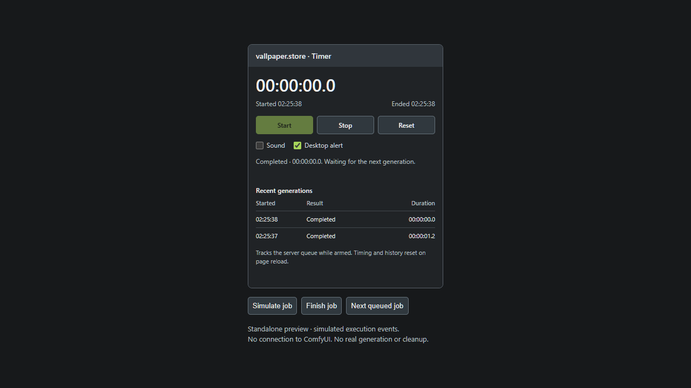

# vallpaper.store · Hardware + Timer

A compact ComfyUI node pack: live hardware monitoring, **Free VRAM**, and a generation timer with completion alerts.

Keep hardware usage and generation times beside your workflow. Both nodes work without connections, a separate dashboard, or an account.

| Node | Purpose |
| --- | --- |
| **vallpaper.store · Hardware** | CPU, RAM, GPU, VRAM, thermal readings, and idle model cleanup |
| **vallpaper.store · Timer** | Start/stop timing, queued-job handoff, recent durations, and completion alerts |

## Hardware


*Standalone UI preview with sample readings. The installed node reads your hardware live.*

### Readings

| Reading | What it measures |
| --- | --- |
| CPU | Total system CPU utilization |
| RAM | System memory in use / total, based on available memory |
| GPU | NVIDIA GPU utilization |
| VRAM | Whole-device memory in use / total, including other applications |
| Temperature | GPU temperature in °C |
| Power | Current GPU power draw in watts |
| Fan | GPU fan speed as a percentage, when exposed by the driver |
| ComfyUI RAM | Resident memory used by the ComfyUI server process |

- Refreshes approximately every **two seconds** while the browser tab is visible.
- Changes usage bars to amber at **90% utilization**.
- Shares cached hardware samples across nodes and browser clients.
- Stops polling when the node is removed.
- Runs hardware sampling outside ComfyUI's HTTP event loop.
- CPU and RAM continue working when NVIDIA readings are unavailable.

Memory quantities use **GiB** (1 GiB = 1,073,741,824 bytes).

## Timer



*Standalone timer preview with simulated execution events.*

1. Add **vallpaper.store · Timer**. Click ComfyUI's **Run / Generate** button (or its queue shortcut). The timer starts automatically through ComfyUI's `promptQueueing` event.
2. The timer records the submission time. Its own **Start** button is an optional manual override, including for an already-running generation.
3. On completion, the timer saves the start time, end time, duration, and result, then alerts you.
4. It stays **armed**: the next queued generation starts a fresh timer automatically.
5. **Stop** disarms timing. **Reset** disarms and clears timing/history. Neither button cancels generation.

The first measured interval begins at your Run/Generate click, so it includes submission and queue waiting. A manual Start click mid-generation measures the remaining time. Subsequent queued jobs use their observed execution start times, excluding the gap between jobs. Adding more jobs while one is running does not reset the active timer. If a frontend does not expose the submission event, `execution_start` also starts the timer automatically at execution. Stop/Reset pause automatic execution-event attachment until the next local Run/Generate click or manual Start. A rejected submission that never executes can be stopped/reset manually.

### Alerts and history

- **In-node alerts** show completion, the next generation starting, failures, and cancellations.
- **Sound** plays a short two-beep alert when a generation ends. Start unlocks audio through your browser's normal user-gesture requirement. Sound can be switched off.
- **Desktop alert** is optional. Enabling it asks for browser notification permission; the node does not request permission on its own. Completion and next-job notifications share a notification tag to avoid stacking rapid queue alerts.
- History keeps the **10 most recent intervals**. Hover over a row for its full start/end timestamps and prompt ID.
- A missed completion followed by an observed new job is labeled **Next job started**, rather than claiming the previous generation succeeded.

The timer listens to ComfyUI execution events and checks the queue/current prompt history every three seconds while armed. This helps it attach to an already-running job and recover a missed completion. Stop, Reset, and node removal prevent late responses from restarting timing.

### Timer limitations

- Keep the browser page open and the timer node present. This is a browser-side timer, not a persistent server-side job recorder.
- Timing and history reset on page reload. Each timer node has its own session and notifications.
- While armed, it follows the **server queue**, including other workflows/clients that the queue polling observes.
- A browser suspended through several short jobs may miss intermediate jobs. Queue polling cannot reconstruct an entire unseen session.
- Desktop notifications depend on browser permission and OS notification settings. Sound depends on autoplay policy, browser audio, and system volume. In-node alerts work without either permission.
- Times use wall-clock timestamps, not benchmark-grade profiling; system clock changes can affect durations. A poll-discovered job without a start event is timed from when it is observed.

## Installation

From your ComfyUI `custom_nodes` directory:

```bash
git clone https://github.com/dharaniVibeDev/ComfyUI-vallpaper-hardware.git vallpaper-hardware-monitor
```

Restart ComfyUI, then refresh the browser. Right-click the canvas and select:

**Add Node → vallpaper.store → vallpaper.store · Hardware**

or **Add Node → vallpaper.store → vallpaper.store · Timer**

You can also search for **vallpaper** in node search. No inputs or outputs need connecting. The monitor runs independently of generation.

### Windows example

```powershell
cd C:\ComfyUI\custom_nodes
git clone https://github.com/dharaniVibeDev/ComfyUI-vallpaper-hardware.git vallpaper-hardware-monitor
```

For a portable installation, use the `ComfyUI\custom_nodes` folder inside your portable directory.

### Dependencies

Python dependencies are **psutil** and **aiohttp**, already requirements of current ComfyUI. GPU readings use **nvidia-smi** from the NVIDIA driver. This node does not install or replace PyTorch, CUDA, Triton, SageAttention, or drivers.

## Free VRAM

Click **Free VRAM** when ComfyUI is idle.

1. The server checks whether jobs are running or queued.
2. If busy, cleanup is refused and the node tells you to wait.
3. If idle, it sets ComfyUI's native `unload_models` and `free_memory` flags.
4. ComfyUI's executor handles cleanup. Watch the VRAM reading for the result.

**This unloads ComfyUI models.** The next generation reloads the models it needs and may take longer to start. Workflow definitions, model files, and saved outputs are not deleted.

It does not interrupt a render, close other applications, reset the GPU, or free memory belonging to Windows, browsers, games, or other Python processes. Driver/context memory may remain allocated. A cleanup request is not a promise that VRAM usage will reach zero.

## Compatibility and limitations

- Developed against **ComfyUI 0.42.1** and its standard DOM-widget extension API.
- Hardware sampling verified on **Windows with an RTX 5060 Ti**.
- NVIDIA metrics require `nvidia-smi` on `PATH`.
- The current UI displays the **first NVIDIA GPU**, not a selectable device list.
- AMD, Intel, and Apple GPU metrics are not implemented. CPU/RAM readings remain available.
- Missing or unsupported GPU readings display **—**, not a fabricated zero.
- Refresh timing can exceed two seconds when a driver query is slow. Hidden tabs pause polling.
- Usage reflects the whole machine/GPU; this is not a per-node profiler or execution-time estimator.
- Tests cover the backend and an isolated browser preview. Full canvas integration and real executor cleanup require a live installation test; simulated cleanup tests do not unload real models.

## Troubleshooting

| Symptom | What to check |
| --- | --- |
| Node is missing | Put the entire repository folder inside `custom_nodes`, restart ComfyUI, and refresh the browser. |
| CPU/RAM work but GPU readings do not | Run `nvidia-smi` in the terminal that starts ComfyUI. Check the driver and PATH. |
| A temperature, fan, or power value is — | The driver may not expose that reading. Other available readings still update. |
| Free VRAM says to wait | Let running and queued jobs finish, then click again. |
| VRAM stays partly occupied | The reading includes Windows and other apps. Some driver/context allocations also remain after cleanup. |
| Monitor reports a connection error | Check the ComfyUI terminal and refresh after restarting. Requests time out rather than leaving the button stuck indefinitely. |
| Timer does not start automatically | Refresh the browser to load the updated extension, then click ComfyUI Run/Generate. Start is an optional manual override. |
| Timer does not make a sound | Check Sound, click Start to unlock browser audio, and check tab/system volume. |
| Desktop alerts do not appear | Enable Desktop alert, allow notifications for your ComfyUI origin, and check OS notification settings. |

## Privacy

The node reads local hardware counters and communicates with your ComfyUI server. It makes **no outbound internet requests** and uploads no telemetry. Its local endpoints follow the access controls of your ComfyUI server.

## Development

```text
__init__.py         Node registration and local API routes
hardware.py         CPU/RAM collector and NVIDIA query parser
web/hardware.js     ComfyUI canvas integration
web/monitor.js      Monitor UI and cleanup action
web/timer.js        Timer canvas integration
web/timer-state.js  Generation timing state machine
web/timer-ui.js     Timer controls, alerts, history, and queue recovery
tests/              Hardware, timing, route, and isolated browser checks
preview.html        Standalone preview using labeled sample data
timer-preview.html  Timer preview using simulated execution events
```

Run tests with the Python environment used by ComfyUI:

```bash
python -m unittest discover -s tests -v
```

Tests simulate the ComfyUI server. They cover unit conversion, unavailable GPU values, driver timeouts, idle cleanup requests, refusal during running/pending jobs, and shared sample caching. They never unload real models.

Timer state tests use Node.js without installing npm dependencies:

```bash
node tests/timer-state.test.mjs
```

These cover click-time behavior, queued-job handoff, duplicate/stale events, fallback labeling, stop/reset, restarting during the same job, failures, cancellations, history limits, and elapsed time after delayed UI updates.

For the visual preview, run the following **from this repository folder**, then open `http://127.0.0.1:8874/preview.html`:

```bash
python -m http.server 8874 --bind 127.0.0.1
```

The hardware preview uses sample data and cannot unload models. Open `/timer-preview.html` on the same server for simulated timer controls. The optional `tests/browser_checks.js` and `tests/timer-browser-checks.js` are Playwright CLI `run-code` scripts; they require that preview server and a separate test browser session. Browser checks simulate notifications; they do not run generation or send OS notifications.

## Updates and removal

Update with `git pull` inside this repository folder, then restart ComfyUI and refresh the browser.

To remove it, delete its folder from `custom_nodes` while ComfyUI is stopped, then restart. Remove monitor nodes from workflows that contain them.

## License

[MIT](LICENSE) · Created by [dharaniVibeDev](https://github.com/dharaniVibeDev) for **vallpaper.store**.
