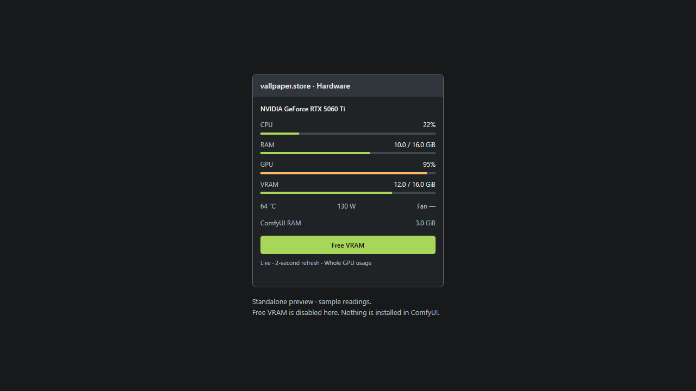

# vallpaper.store · Hardware

A compact hardware monitor for ComfyUI, with a **Free VRAM** button that uses ComfyUI's own model-unload mechanism.

Keep CPU, system RAM, GPU load, and VRAM visible beside your workflow. No node connections, separate dashboard, or account needed.



*Standalone UI preview with sample readings. The installed node reads your hardware live.*

## Features

| Reading | What it measures |
| --- | --- |
| CPU | Total system CPU utilization |
| RAM | System memory in use / total, based on available memory |
| GPU | NVIDIA GPU utilization |
| VRAM | Whole-device memory in use / total, including other applications |
| Temperature | GPU temperature in °C |
| Power | Current GPU power draw in watts |
| Fan | GPU fan speed as a percentage, when exposed by the driver |
| ComfyUI RAM | Resident memory used by the ComfyUI server process |

- Refreshes approximately every **two seconds** while the browser tab is visible.
- Changes usage bars to amber at **90% utilization**.
- Shares cached hardware samples across nodes and browser clients.
- Stops polling when the node is removed.
- Runs hardware sampling outside ComfyUI's HTTP event loop.
- CPU and RAM continue working when NVIDIA readings are unavailable.

Memory quantities use **GiB** (1 GiB = 1,073,741,824 bytes).

## Installation

From your ComfyUI `custom_nodes` directory:

```bash
git clone https://github.com/dharaniVibeDev/ComfyUI-vallpaper-hardware.git vallpaper-hardware-monitor
```

Restart ComfyUI, then refresh the browser. Right-click the canvas and select:

**Add Node → vallpaper.store → vallpaper.store · Hardware**

You can also search for **vallpaper** in node search. No inputs or outputs need connecting. The monitor runs independently of generation.

### Windows example

```powershell
cd C:\ComfyUI\custom_nodes
git clone https://github.com/dharaniVibeDev/ComfyUI-vallpaper-hardware.git vallpaper-hardware-monitor
```

For a portable installation, use the `ComfyUI\custom_nodes` folder inside your portable directory.

### Dependencies

Python dependencies are **psutil** and **aiohttp**, already requirements of current ComfyUI. GPU readings use **nvidia-smi** from the NVIDIA driver. This node does not install or replace PyTorch, CUDA, Triton, SageAttention, or drivers.

## Free VRAM

Click **Free VRAM** when ComfyUI is idle.

1. The server checks whether jobs are running or queued.
2. If busy, cleanup is refused and the node tells you to wait.
3. If idle, it sets ComfyUI's native `unload_models` and `free_memory` flags.
4. ComfyUI's executor handles cleanup. Watch the VRAM reading for the result.

**This unloads ComfyUI models.** The next generation reloads the models it needs and may take longer to start. Workflow definitions, model files, and saved outputs are not deleted.

It does not interrupt a render, close other applications, reset the GPU, or free memory belonging to Windows, browsers, games, or other Python processes. Driver/context memory may remain allocated. A cleanup request is not a promise that VRAM usage will reach zero.

## Compatibility and limitations

- Developed against **ComfyUI 0.42.1** and its standard DOM-widget extension API.
- Hardware sampling verified on **Windows with an RTX 5060 Ti**.
- NVIDIA metrics require `nvidia-smi` on `PATH`.
- The current UI displays the **first NVIDIA GPU**, not a selectable device list.
- AMD, Intel, and Apple GPU metrics are not implemented. CPU/RAM readings remain available.
- Missing or unsupported GPU readings display **—**, not a fabricated zero.
- Refresh timing can exceed two seconds when a driver query is slow. Hidden tabs pause polling.
- Usage reflects the whole machine/GPU; this is not a per-node profiler or execution-time estimator.
- Tests cover the backend and an isolated browser preview. Full canvas integration and real executor cleanup require a live installation test; simulated cleanup tests do not unload real models.

## Troubleshooting

| Symptom | What to check |
| --- | --- |
| Node is missing | Put the entire repository folder inside `custom_nodes`, restart ComfyUI, and refresh the browser. |
| CPU/RAM work but GPU readings do not | Run `nvidia-smi` in the terminal that starts ComfyUI. Check the driver and PATH. |
| A temperature, fan, or power value is — | The driver may not expose that reading. Other available readings still update. |
| Free VRAM says to wait | Let running and queued jobs finish, then click again. |
| VRAM stays partly occupied | The reading includes Windows and other apps. Some driver/context allocations also remain after cleanup. |
| Monitor reports a connection error | Check the ComfyUI terminal and refresh after restarting. Requests time out rather than leaving the button stuck indefinitely. |

## Privacy

The node reads local hardware counters and communicates with your ComfyUI server. It makes **no outbound internet requests** and uploads no telemetry. Its local endpoints follow the access controls of your ComfyUI server.

## Development

```text
__init__.py         Node registration and local API routes
hardware.py         CPU/RAM collector and NVIDIA query parser
web/hardware.js     ComfyUI canvas integration
web/monitor.js      Monitor UI and cleanup action
tests/              Hardware, route, and isolated browser checks
preview.html        Standalone preview using labeled sample data
```

Run tests with the Python environment used by ComfyUI:

```bash
python -m unittest discover -s tests -v
```

Tests simulate the ComfyUI server. They cover unit conversion, unavailable GPU values, driver timeouts, idle cleanup requests, refusal during running/pending jobs, and shared sample caching. They never unload real models.

For the visual preview, run the following **from this repository folder**, then open `http://127.0.0.1:8874/preview.html`:

```bash
python -m http.server 8874 --bind 127.0.0.1
```

The preview uses sample data and cannot unload models. The optional `tests/browser_checks.js` is a Playwright CLI `run-code` script; it requires that preview server and a separate test browser session.

## Updates and removal

Update with `git pull` inside this repository folder, then restart ComfyUI and refresh the browser.

To remove it, delete its folder from `custom_nodes` while ComfyUI is stopped, then restart. Remove monitor nodes from workflows that contain them.

## License

[MIT](LICENSE) · Created by [dharaniVibeDev](https://github.com/dharaniVibeDev) for **vallpaper.store**.
